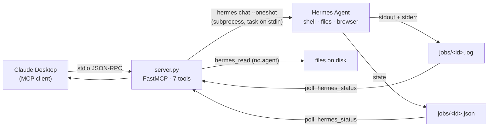

# claude-hermes-bridge

**Give Claude Desktop an executor.** A local [MCP](https://modelcontextprotocol.io/) server that lets
Claude Desktop hand a task to a [Hermes Agent](https://hermes-agent.nousresearch.com/) running on the
same Windows machine, and read the raw evidence back. It is for people who already run Hermes — a
general agent with shell, file and browser tools — and who use Claude Desktop as their planner.

State: working and in daily use on one machine, but **single-user and Windows-first**. The server side
is verified (see [Status](#status)); a tool call driven from inside the Claude Desktop chat window is
not. Do not expose this to anything but your own desktop.

Claude plans and verifies; Hermes executes. Every tool returns in seconds — long work runs as a
background job you poll, because Claude Desktop kills any MCP tool call that outlives its own timeout.



## What it does

Claude Desktop is a good planner with no hands. Hermes is a capable executor that runs unattended and
cannot ask questions. This server is the seam between them, over MCP's **stdio transport**: Claude
Desktop spawns `server.py` as a child process and speaks JSON-RPC to it on stdin/stdout. The server
exposes **seven tools** — `hermes_run`, `hermes_resume`, `hermes_status`, `hermes_jobs`, `hermes_read`,
`hermes_capabilities`, `hermes_health` — and drives the `hermes` CLI as a subprocess. It also tells
Claude what Hermes can do, via an `INSTRUCTIONS` string the SDK hands to the client at connect time.

The whole design rests on one constraint, explained next.

## The architecture

A stdio MCP server has exactly one hard rule: **stdout is the protocol.** Every line the server writes
to stdout is a JSON-RPC message. The single most likely way to break this file is a stray `print()`.
All diagnostics go to stderr, which is why `_log()` writes there and nowhere else.

The second rule shapes everything else. Claude Desktop kills any tool call that runs past its own
timeout (`mcpToolTimeoutMs`, 180 s by default). A Hermes task routinely takes longer than that — the
CLI cold-starts in 10-40 s before doing any work. So **no tool here may block**. Work runs as a
background job; the call returns a job id; the caller polls.

```mermaid
sequenceDiagram
    participant CD as Claude Desktop
    participant S as server.py
    participant H as hermes chat
    CD->>S: hermes_run(task, cwd, wait_s)
    S->>H: Popen(hermes chat --oneshot …, stdin=task)
    S-->>CD: STATUS: running · JOB_ID: 20261106-101500-1 · (tail so far)
    Note over CD: returns in ~wait_s seconds
    Note over S,H: monitor thread runs; output → jobs/&lt;id&gt;.log
    CD->>S: hermes_status("20261106-101500-1", wait_s=180)
    S-->>CD: STATUS: ok · EXIT_CODE: 0 · --- HERMES OUTPUT --- …
    CD->>S: hermes_read("…/result.txt")
    S-->>CD: the file, so Claude can verify for itself
```

## The tools

| Tool | Required args | What it does |
| --- | --- | --- |
| `hermes_run` | `task` | Run a fresh Hermes task: shell, files, browsing, and Hermes' skill library. Returns the result or a job id. |
| `hermes_resume` | `session_id`, `task` | Continue an earlier Hermes session with its context intact (`session_id="latest"` for the most recent). Cheaper than re-running when you are correcting work in progress. |
| `hermes_status` | `job_id` | Collect a background job's result. Waits up to `wait_s` (default 30), then reports the result or `STATUS: running` again. Reads from disk, so any session can call it. |
| `hermes_jobs` | — | List jobs on disk, oldest first, with state and duration. Cheap; no agent involved. |
| `hermes_read` | `path` | Read a file, or list a directory, **without waking an agent**. This is how Claude verifies a claim instead of trusting it. |
| `hermes_capabilities` | — | Hermes' procedural-skill index, read from disk. No args = a category summary; `query="latex"` or `category="cad"` narrows it. |
| `hermes_health` | — | Is the Hermes executable present, what version, how many jobs. Instant; never spawns the CLI. |

## How a long task comes back

This is the part that is easy to get wrong, so here is exactly what the code does.

**Nothing is injected back into the conversation, and there is no `/continue` command.** An MCP tool
returns a value, and that value is the tool's result content — a text block in the JSON-RPC response.
The server never writes a user message and has no special "continue" verb. Continuity is a *job id* the
model is told to poll, plus `hermes_resume` for continuing an agent session.

The sequence, per `_launch_and_wait` / `_start_job` / `_monitor` / `_render_disk` in `server.py`:

1. `hermes_run` resolves the working directory (see [Project scoping](#project-scoping)), then checks
   for an identical already-running job (`_find_duplicate`). If one exists it returns *that* job instead
   of starting a second worker — because Claude re-issues calls it thinks failed, and two agents editing
   one tree is worse than a slow result.
2. `_start_job` launches
   `hermes chat --query-file - -Q --oneshot --in <cwd> --max-turns N [--resume …] [--skills …] [--toolsets …]`.
   The task text is written to the child's **stdin** (`--query-file -`), so nothing is shell-interpreted.
   The child's stdout+stderr go straight to a **file**, `jobs/<id>.log`, not a pipe — no reader threads to
   deadlock, and nothing is lost when the server process later exits. State goes to `jobs/<id>.json`.
3. A detached `_monitor` thread watches the process and enforces the server's own hard cap
   (`default_timeout_s`, 1800 s). If the job overruns it is killed and recorded as `timeout`.
4. `_launch_and_wait` blocks for at most `wait_s` (default 5 s) — comfortably under Claude's 180 s — then
   calls `_render_disk`, which returns text like:

   ```
   STATUS: running
   JOB_ID: 20261106-101500-1
   CWD: C:\Users\<you>\claude-work
   ELAPSED_S: 5
   TIMEOUT_S: 1800 (hard cap we enforce)
   FULL_LOG: C:\...\jobs\20261106-101500-1.log

   Still running. This is NOT a failure and NOT a timeout.
   Collect the result with hermes_status(job_id="20261106-101500-1").
   Do not re-run the task -- it is already executing.

   --- OUTPUT SO FAR (tail) ---
   …up to 2000 chars of the tail…
   ```

5. The caller polls `hermes_status(job_id, wait_s)`. When the job finishes, `_render_disk` returns the
   final block instead: `STATUS: ok|error|timeout`, `EXIT_CODE`, and `--- HERMES OUTPUT ---` with up to
   `max_output_chars` of the log.

**Why on-disk rather than in memory.** Claude Desktop starts a **new** `server.py` instance per session.
A job launched by one instance has to be answerable by whichever instance asks next. Anything held only
in the launching process is invisible to the one that needs it. So `_read_job` reads the JSON from disk
and re-checks liveness:

- state `running`, recorded pid is dead, and no exit code was ever written → **`orphaned`** (the owning
  server died mid-job). Reported honestly, not left as `running` forever.
- state `running`, no pid recorded (older job files) → **`running_untracked`**; assumed alive, because
  falsely claiming a live job died invites a duplicate re-run.

There are no background threads surviving the process on purpose: the outcome is written by the
*monitor* thread of whichever process owns the job, and if that process dies the next one infers
`orphaned` from the disk state. Nothing is cached in a way that a fresh process cannot reconstruct.

## Project scoping

An MCP tool is an **unattended shell** — Claude calls it with no human in the loop at call time. So the
default posture is "nothing outside these directories". `_resolve_cwd` resolves the requested `cwd`
(or `default_cwd`) to an absolute path and refuses the call with `STATUS: refused` unless the path sits
inside one of `allowed_roots` in `config.json`. No subprocess starts on a refusal.

Two honest caveats:

- Confinement is on the working directory, not on every path the agent then touches. This scopes *where
  a job starts*. See [Security](#security).
- `hermes_read` is **not** confined by this list. It reads whatever path you give it — by design, since
  Claude has to be able to inspect artifacts. Treat read access as "anything the server process can read".

Adding a root, and what the model is told about paths, is in [docs/add-a-project.md](docs/add-a-project.md).

## What it can and cannot do

**Can**

- Run real work on the machine: execute code, build documents, install packages, compile, fetch pages —
  through Hermes' own toolsets and its several-hundred-skill library.
- Read any file back to the caller so Claude verifies against the filesystem, not against a claim.
- Continue a prior Hermes session, and report on jobs started by an earlier server process.
- Tell Claude what Hermes can do before it plans (`hermes_capabilities`).

**Cannot**

- Ask you a question mid-task. Hermes runs unattended; every task must be self-contained with an explicit
  definition of "done" and absolute paths.
- Authenticate anyone. There is no auth, because there is no network surface (see Security).
- Undo a task it hard-killed. `STATUS: timeout` means the work may be part-done; inspect the directory
  before re-running. `hermes_run` is not idempotent.
- Run unmodified on macOS or Linux. `_pid_alive()` uses `ctypes.windll`, and the launcher is a `.cmd`.
- Guarantee a clean error when the server itself fails to start — that failure surfaces on the client
  side (see [Known issues](#known-issues)).

## Requirements

- **Windows.** `_pid_alive()` uses `ctypes.windll`; the launcher is `run_server.cmd`.
- **Python 3.10+** (the code uses `X | None` type syntax and `from __future__ import annotations`).
- **The MCP Python SDK, pinned below 2.0** — `mcp>=1.2,<2` (see `requirements.txt`). `server.py` imports
  `from mcp.server.fastmcp import FastMCP`; that module is present in the SDK 1.x line and moved in
  2.0.0. Verified against `mcp 1.26.0`.
- **Hermes Agent** installed, the `hermes` CLI on disk, and a path to it in `config.json`. The machine
  this was built against runs Hermes **0.21.0** (read from disk, 2026-11-06).

## Install on Windows

1. Put the files somewhere stable, e.g. `C:\Users\<you>\Projects\claude-hermes-bridge`.
2. Create a virtual environment and install the one dependency:

   ```bat
   cd C:\Users\<you>\Projects\claude-hermes-bridge
   python -m venv .venv
   .venv\Scripts\python.exe -m pip install -r requirements.txt
   ```

   (Or use any Python that already has `mcp<2` installed — including an existing conda
   environment, which is what the reference machine uses. Whatever interpreter you choose
   must be the one Claude Desktop will spawn, below.)

3. Copy the example config and edit it:

   ```bat
   copy config.example.json config.json
   ```

   Set `hermes_exe` to your real `hermes.exe` path, and set `allowed_roots` / `default_cwd` to the
   directories you want work confined to. `config.json` is git-ignored; it is yours.

4. Smoke-test before wiring it into Claude Desktop:

   ```bat
   .venv\Scripts\python.exe tests\test_bridge.py tools
   ```

   You should see `7 tools registered:` (see [Testing](#testing)).

## Register with Claude Desktop

Claude Desktop reads its MCP servers from `claude_desktop_config.json`. The path depends on the install:

| Install | Path |
| --- | --- |
| Classic (installer) | `%APPDATA%\Claude\claude_desktop_config.json` |
| Microsoft Store (MSIX) | `%LOCALAPPDATA%\Claude-Data\<package-id>\claude_desktop_config.json` |

If unsure which you have, look in both. `register_with_claude.py` finds every `claude_desktop_config.json`
it can and writes the same entry into each, backing the old one up first:

```bat
.venv\Scripts\python.exe register_with_claude.py --print   # show the change, write nothing
.venv\Scripts\python.exe register_with_claude.py           # write it
```

The entry it writes (edit by hand if you prefer):

```json
"mcpServers": {
  "hermes": {
    "command": "C:\\Users\\<you>\\Projects\\claude-hermes-bridge\\.venv\\Scripts\\python.exe",
    "args": ["C:\\Users\\<you>\\Projects\\claude-hermes-bridge\\server.py"]
  }
}
```

`command` must be the interpreter that has `mcp<2`; `args[0]` must be the absolute path to `server.py`.
Then **restart Claude Desktop** — it re-reads this file only at startup, and spawns a fresh server
process per session.

## Testing

`tests/test_bridge.py` drives the server over a real stdio MCP connection. Run it with the interpreter
that will run the server:

```bat
python tests\test_bridge.py tools        # list the tools
python tests\test_bridge.py health        # hermes_health (instant, no agent)
python tests\test_bridge.py run "<task>"  # a real hermes_run
python tests\test_bridge.py poll <job_id> # hermes_status
```

Output of `tools` against this repo (verbatim, one server process, `mcp 1.26.0`):

```
7 tools registered:

  hermes_run(task, cwd, max_turns, timeout_s, wait_s, skills, toolsets)
      required: ['task']
  hermes_resume(session_id, task, cwd, max_turns, timeout_s, wait_s)
      required: ['session_id', 'task']
  hermes_status(job_id, wait_s)
      required: ['job_id']
  hermes_jobs()
  hermes_read(path, max_bytes)
      required: ['path']
  hermes_capabilities(query, category, limit)
  hermes_health()
```

The other tests exercise the job model and need a live Hermes install on a warm machine:

| File | What it proves |
| --- | --- |
| `tests/jobtest.py` | A short `wait_s` returns `STATUS: running`, the job keeps going, and `hermes_status` later collects the real result — all inside one server session. |
| `tests/e2e_newmodel.py` | `hermes_run` returns fast; a *separate* process reads the job and sees a live pid; an identical retry is deduped instead of starting a second worker. |
| `tests/test_crossinstance.py` | The disk-backed job model from a process that started no jobs — the "next server instance" case. |
| `tests/probe_job.py` | Helper: reads one job from a separate interpreter (used by `e2e_newmodel.py`). |

## Known issues

Honest list. Nothing here is fixed by re-reading the README.

- **`Client.listTools() called but server does not advertise tools capability`.** This message is
  emitted by the **MCP client**, not by `server.py` — the string does not appear anywhere in this repo.
  The server registers its tools with FastMCP decorators and declares **no explicit capability block**;
  the SDK advertises the `tools` capability based on the registered tools. I could not determine the
  cause from the server source, and I have not reproduced it here, so I will not guess one. What is
  checkable when it happens: whether the server process actually starts (its stderr, and whether
  `jobs/`/`logs/` appear beside `server.py`), whether `command` points at an interpreter with `mcp<2`,
  whether `args[0]` is the correct absolute path, and whether Claude Desktop was restarted after the
  config edit. This came up in this session's log and is recorded as unexplained, not as a fix.

- **The SDK version pin is load-bearing.** `server.py` imports `from mcp.server.fastmcp import FastMCP`.
  That module exists in the `mcp` 1.x line (1.26.0 is what the reference machine runs) and is **not** at
  that path in `mcp` 2.0.0. Install the wrong major and the server fails to import — which surfaces to
  the client as a server with no tools, not as a clear error. `requirements.txt` pins `<2` for this reason.

- **Windows-only internals.** `_pid_alive()` uses `ctypes.windll.kernel32` (with a `psutil` fallback,
  and a "cannot tell → assume alive" default). `run_server.cmd` is batch. Porting is real work, not a
  README edit.

- **Cold start is slow and variable.** Measured 9-35 s of pure Hermes startup before any work, with high
  variance under load. A task that finishes in under a minute is normal even when trivial; `hermes_health`
  is the instant way to check the install without paying for a start.

- **A hard kill leaves part-done work.** `STATUS: timeout` means the 1800 s cap was hit and the process
  was killed. Inspect the working directory before re-running; `hermes_run` is not idempotent.

## Security

Read this before you widen the allow-list or hand this to anyone else.

- **Local, stdio, no network, no auth.** The server is a child process of Claude Desktop talking over
  pipes. It opens no socket and listens on no port. There is no authentication because there is no
  remote surface to authenticate — anyone who can write Claude Desktop's config can already run code on
  the machine. **Do not wrap this in a network transport.** Adding HTTP/SSE would turn "an unattended
  shell for one desktop user" into "an unauthenticated remote shell", which is a different and much worse
  product.
- **What it can touch.** The working directory of each job is confined to `allowed_roots`. Beyond that,
  Hermes runs with whatever its own toolsets allow inside that directory, and it inherits the server's
  environment — so any secret in that environment is reachable by a task. `hermes_read` reads any local
  path the server process can read, outside the allow-list too, by design.
- **It is an unattended executor.** The realistic blast radius is "a command the agent chooses, run as
  you, with your files". Treat a task written by Claude as a script written by Claude: give it a narrow
  `cwd`, a definition of done, and verify the artifact afterwards with `hermes_read` rather than trusting
  `STATUS: ok`.
- **No secrets belong in these files.** `server.py` holds none; it forwards the ambient environment to the
  subprocess. `config.json` holds paths, not credentials, and is git-ignored. If you fork this, keep it
  that way.

## What is in here

| Path | What |
| --- | --- |
| `server.py` | The MCP server. stdio transport, seven tools, the job model. |
| `requirements.txt` | One dependency, pinned `mcp>=1.2,<2`, with the reason. |
| `run_server.cmd` | Windows launcher for running the server by hand when debugging. |
| `register_with_claude.py` | Writes the `mcpServers.hermes` entry into Claude Desktop's config(s). |
| `config.example.json` | Template for `config.json`; placeholders, no real paths. |
| `docs/add-a-project.md` | The project-scoping model and how to add an allowed root. |
| `docs/owner-todos.md` | Open items for the owner (screenshot, licence line, etc.). |
| `tests/` | Smoke test plus the job-model and cross-instance tests. |
| `README.md`, `LICENSE`, `CREDITS.md` | This file; MIT; attributions. |

Not in here, on purpose: `config.json` (yours), `jobs/` and `logs/` (runtime state, git-ignored), and
the machine-specific diagnostics and one-off scripts used while building it.

## Status

- **Verified:** the server lists **7 tools** over a real stdio MCP connection, and `hermes_health`
  returns `STATUS: ok` with the executable present — both re-run against this exact `server.py` (the
  output is in [Testing](#testing)).
- **Verified, earlier:** a real `hermes_run` wrote a file and the content was confirmed byte-for-byte by
  independent `od` inspection (from the repo's own logs when it was built).
- **Not verified here:** a tool call *driven from a Claude Desktop chat*. That needs the GUI. The claim
  that Claude Desktop spawns and connects to the server is from the build machine's client log, not from
  a fresh run in this repo.

## Credits

- **Model Context Protocol** — the spec this speaks. Anthropic, <https://modelcontextprotocol.io/>.
  The server follows the stdio transport and tool surface; the client negotiated protocol revision
  `2025-11-25`.
- **MCP Python SDK** (`mcp`) — <https://github.com/modelcontextprotocol/python-sdk>. The server uses the
  `FastMCP` convenience class.
- **Hermes Agent** by **Nous Research** — the executor. <https://hermes-agent.nousresearch.com/>
- Two Hermes skills shaped this: **`claude-code`** (the plan/execute split this inverts) and
  **`claude-hermes-bridge`** (the operating rules that became the server's `INSTRUCTIONS`).

Full attributions in [CREDITS.md](CREDITS.md).

## Licence

MIT — see [LICENSE](LICENSE). Copyright (c) 2026 Chen Bin.
